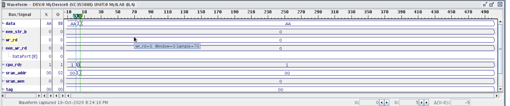
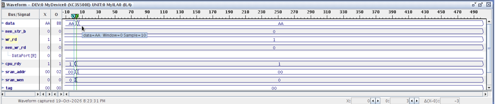
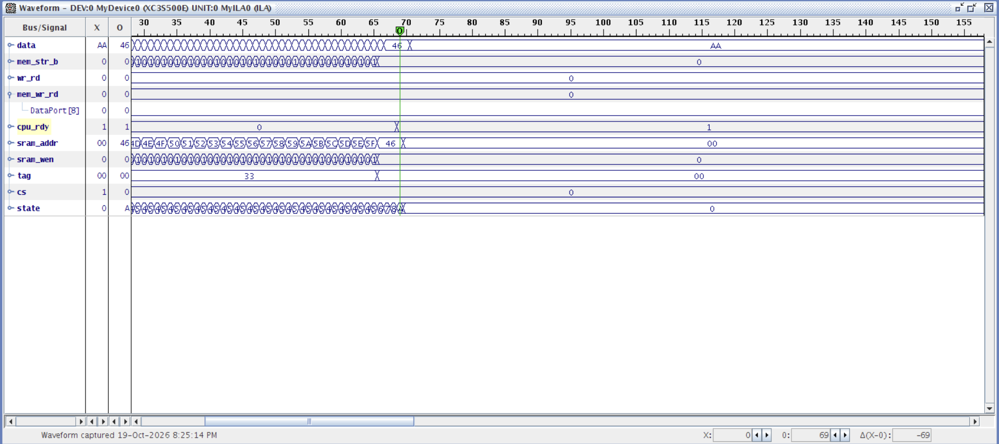
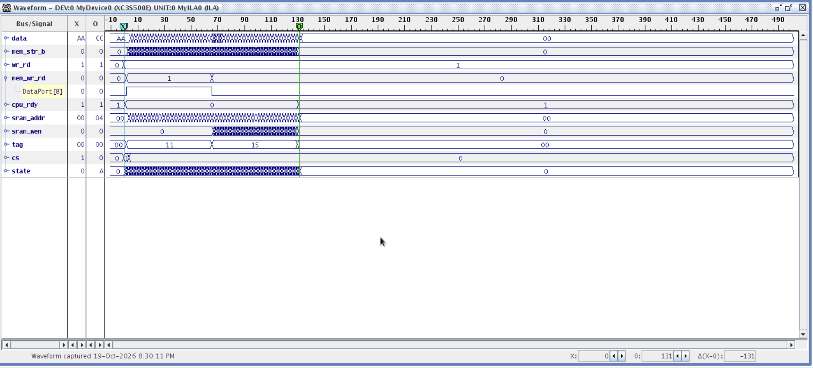

# FPGA Cache Controller — Hardware Verification

## Overview

This directory documents the **on-chip verification** of a 256-byte direct-mapped cache controller implemented in VHDL on a **Xilinx Spartan-3E FPGA**.

The controller uses an 11-state finite-state machine (FSM) to manage CPU read/write requests, cache hit/miss detection, and dirty-block write-back. It interfaces with a 256 × 8-bit BRAM cache and a 2 KB SDRAM-style memory model.

Verification was performed using **Xilinx ChipScope Pro (ILA)** to capture internal control signals and memory transactions directly from the FPGA.

Four functional scenarios were tested: read hit, write hit, clean miss, and dirty miss.

## Key Signals

| Signal | Description |
|---|---|
| `wr_rd` | CPU operation: `0` = read, `1` = write |
| `mem_wr_rd` | Main-memory operation: `0` = read, `1` = write |
| `mem_str_b` | Main-memory transaction strobe |
| `cpu_rdy` | CPU-ready flag: `0` = waiting, `1` = ready |
| `sram_addr` | Cache memory address |
| `sram_wen` | SRAM write-enable signal |
| `tag` | Cache tag value |
| `state` | Current cache-controller FSM state |

---

## 1. Read Hit

**Scenario:** The CPU reads an address whose data is already present in the cache.

The `wr_rd` signal remains low (`0`), indicating a read operation. Since the requested block is cached, `mem_str_b` remains low, confirming that no main-memory transaction is initiated. The controller services the request directly from the cache without requiring a block refill.

**Result:** Read-hit behavior observed, with no unnecessary SDRAM-style memory access.

---

## 2. Write Hit

**Scenario:** The CPU writes to an address whose block is already present in the cache.

The `wr_rd` signal is high (`1`), indicating a write operation. The controller updates the cached data under its write-back policy, marking the block dirty for future replacement. The `mem_str_b` signal remains low, demonstrating that the write does not immediately initiate a main-memory transaction.

**Result:** Write-hit behavior observed, consistent with write-back caching.

---

## 3. Clean Miss

**Scenario:** The CPU requests data that is not cached, and the selected cache block does not require write-back.

With `wr_rd = 0` and `mem_wr_rd = 0`, the controller performs a read from the SDRAM-style memory interface. The waveform shows sequential address activity during the block transfer, while `cpu_rdy` remains low to stall the CPU. Once the refill completes, `cpu_rdy` returns high.

**Result:** Clean-miss block refill observed, with CPU-ready handshaking and no preceding dirty-block write-back.

---

## 4. Dirty Miss

**Scenario:** A cache miss requires replacement of a modified block that has not yet been written back to main memory.

The `mem_wr_rd` signal initially goes high (`1`), indicating a memory write operation to preserve the dirty block. It subsequently transitions low (`0`), indicating a memory read to fetch the replacement block. Throughout both phases, `cpu_rdy` remains low, preventing the CPU from proceeding until the memory transactions finish.

**Result:** Dirty-block write-back followed by replacement-block refill observed through FPGA waveform capture.

---

## Verification Summary

| Test Case | Main-Memory Activity | Observed Behavior |
|---|---|---|
| Read Hit | None | Cached data accessed without memory fetch |
| Write Hit | None immediately | Cache updated under write-back policy |
| Clean Miss | Block read | CPU stalled until refill completed |
| Dirty Miss | Block write → Block read | Write-back performed before refill |

## Tools & Hardware

- **HDL:** VHDL
- **FPGA:** Xilinx Spartan-3E (XC3S500E)
- **Development:** Xilinx ISE, ISim
- **On-Chip Debugging:** Xilinx ChipScope Pro ILA/VIO
- **Memory:** BRAM cache and synthesizable SDRAM-style memory model

**Verification scope:** These captures demonstrate four functional cache scenarios on FPGA hardware. They do not represent exhaustive verification or testing against a physical DDR interface.
